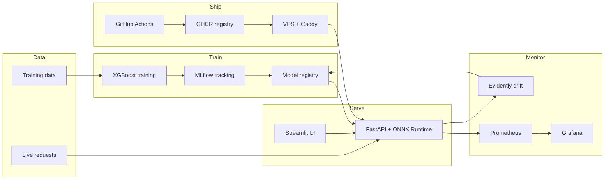
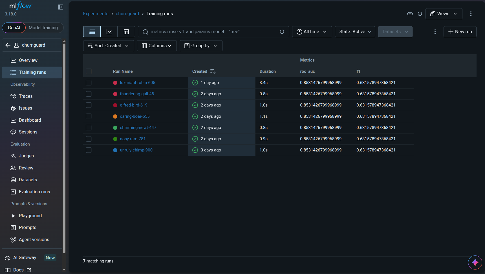
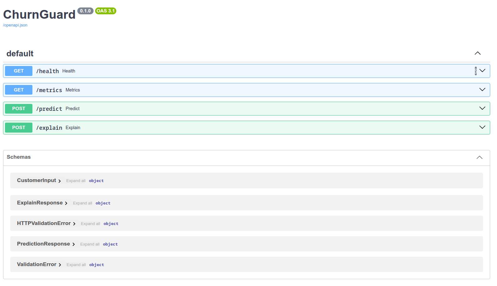
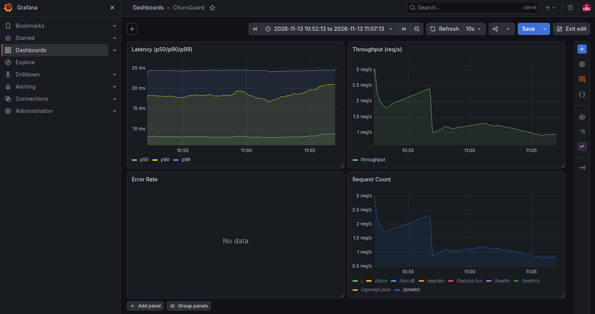
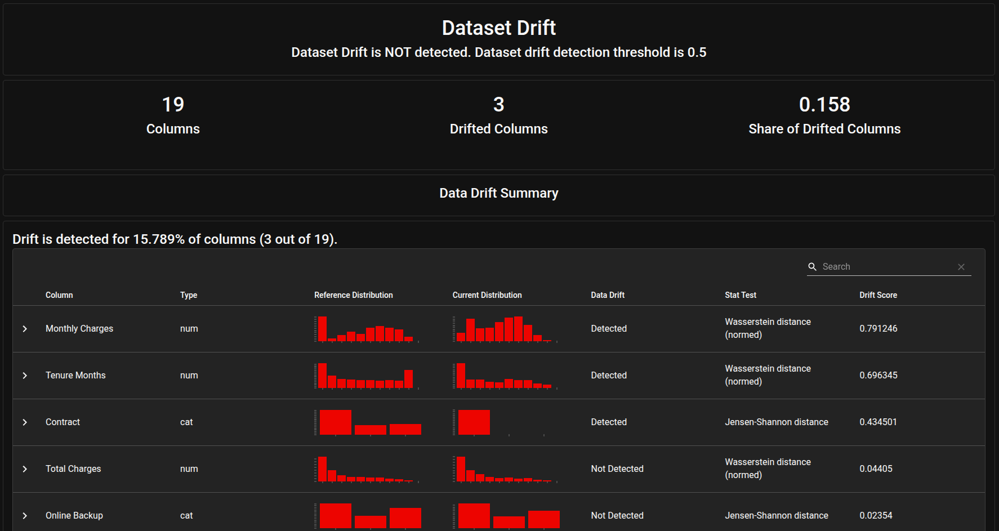
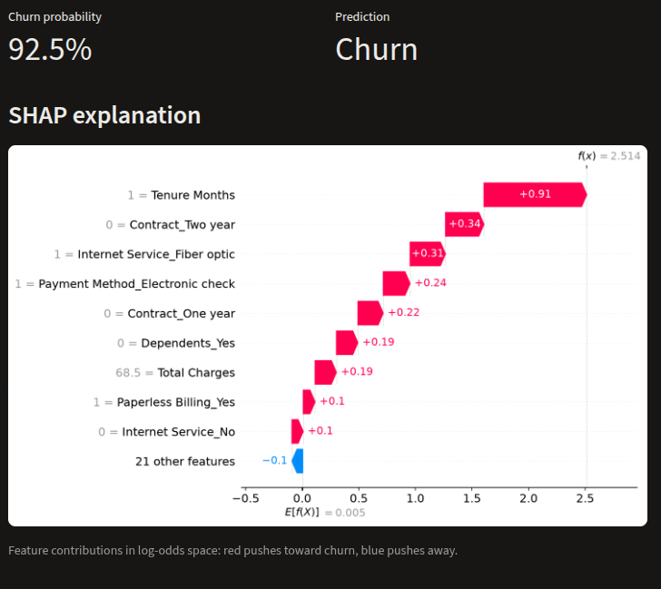
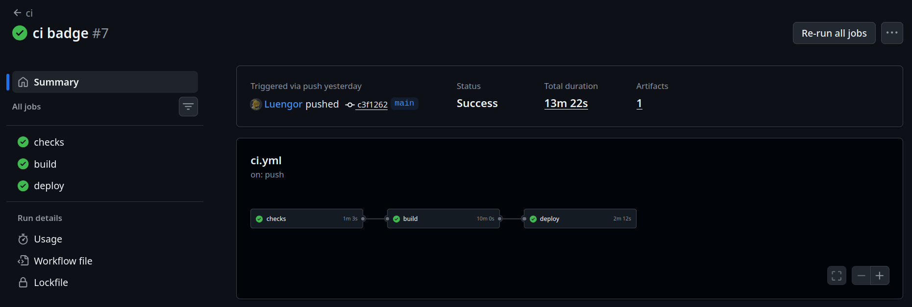

# ChurnGuard

[](https://github.com/Luengor/churnguard/actions/workflows/ci.yml)

End-to-end MLOps pipeline for **customer churn**: train → track → serve → monitor → detect drift → explain, shipped with Docker and CI/CD.


## Features
- **Reproducible training** with MLflow experiment tracking and a model registry
- **Model export to ONNX** and serving via a FastAPI + ONNX Runtime API
- **Input validation** with Pydantic and auto-generated Swagger docs (`/docs`)
- **System monitoring** with Prometheus metrics (latency, throughput, errors, request count) visualized in Grafana
- **Data drift detection** with Evidently (reference vs. current batch)
- **Explainability** with SHAP, exposed in a Streamlit UI
- **Containerization** with Docker Compose
- **CI/CD** with GitHub Actions: lint → type-check → test → build → push to GHCR → deploy to a VPS behind Caddy + HTTPS


## Architecture



## Screenshots














## Tech stack

| Layer | Tool |
|---|---|
| Language | Python 3.12 |
| Packaging | uv + `pyproject.toml` |
| Model | XGBoost → ONNX Runtime |
| Tracking / registry | MLflow |
| API | FastAPI + Pydantic |
| System metrics | Prometheus + Grafana |
| Drift / model health | Evidently AI |
| Explainability | SHAP |
| Demo UI | Streamlit |
| Containerization | Docker + Docker Compose |
| CI/CD | GitHub Actions → GHCR |
| Hosting | Self-hosted VPS + Caddy (HTTPS) |
| Lint / type / test | ruff, mypy, pytest |

## Dataset & model

- **Dataset:** [IBM Telco Customer Churn](https://www.kaggle.com/datasets/blastchar/telco-customer-churn) (~7,000 rows, 21 columns).
- **Model:** XGBoost binary classifier.
- **Primary metric:** ROC-AUC (F1 tracked as secondary).
- **Export format:** ONNX, framework-agnostic inference that signals production readiness.

## Repository structure

```
churnguard/
├── data/                  # Telco dataset + reference/current splits for drift
├── notebooks/             # EDA notebook
├── src/
│   ├── common.py          # shared paths, constants, and feature metadata
│   ├── train.py           # training → MLflow → ONNX export
│   ├── serve.py           # FastAPI app
│   ├── drift.py           # Evidently drift reports
│   └── ui.py              # Streamlit + SHAP
├── models/                # trained XGBoost (JSON) + exported ONNX
├── monitoring/
│   ├── prometheus.yml
│   ├── evidently/         # generated drift reports
│   └── grafana/           # provisioned datasource + dashboard JSON
├── deploy/
│   └── compose.yml        # production compose (prebuilt GHCR image)
├── tests/                 # API + UI tests
├── .github/workflows/ci.yml
├── compose.yml            # local dev compose (builds locally)
├── Dockerfile
├── pyproject.toml
└── uv.lock
```

## Getting started

Requires [uv](https://docs.astral.sh/uv/).

```bash
uv sync
```

### Train + track

```bash
uv run python src/train.py
```

Trains the XGBoost classifier, logs params/metrics/artifacts to a local MLflow server (`mlflow.db`), registers the model, and exports ONNX. It also writes `data/reference.csv` and `data/current.csv` (train/test splits) for the drift demo.

View the run:

```bash
uv run mlflow ui --backend-store-uri sqlite:///mlflow.db
```

### Run locally

```bash
docker compose up --build
```

Brings up the API (`:8000`), Streamlit UI (`:8501`), Prometheus (`:9090`), and Grafana (`:3000`).

Or run the API directly:

```bash
uv run uvicorn serve:app --app-dir src
```

### Drift

```bash
uv run python src/drift.py
```

Generates `monitoring/evidently/baseline.html` (reference vs. current) and `monitoring/evidently/drifted.html` (reference vs. a synthetically drifted batch) to prove the report catches drift.

### Tests

```bash
uv run ruff check .
uv run mypy src
uv run pytest
```

## API

| Endpoint | Method | Description |
|---|---|---|
| `/health` | GET | Liveness check |
| `/metrics` | GET | Prometheus metrics (`http_requests_total`, `http_request_duration_seconds`) |
| `/predict` | POST | Churn probability + boolean label from a validated Pydantic body |
| `/explain` | POST | SHAP contributions (log-odds) for a prediction |

The request schema is generated programmatically from the dataset columns, so it always stays in sync with the source data. See `/docs` for the interactive Swagger UI.

## Monitoring

- **Prometheus** scrapes the API's `/metrics` endpoint.
- **Grafana** (`monitoring/grafana/dashboards/churnguard.json`) is provisioned with a dashboard for latency, throughput, error rate, and request count.
- **Evidently** compares the reference batch against the current batch and a fabricated "drifted" batch, producing HTML drift reports.

## CI/CD & deployment

`.github/workflows/ci.yml` runs on every PR and push to `main`:

1. `ruff check` → `mypy src` → `pytest`
2. Builds a multi-arch (amd64 + arm64) image and pushes to GHCR
3. SSHes to the VPS and runs `docker compose -f deploy/compose.yml up -d`

`deploy/compose.yml` pulls the prebuilt GHCR image and binds ports from environment variables (see `.env.example`), with Caddy terminating HTTPS in front of the API.
